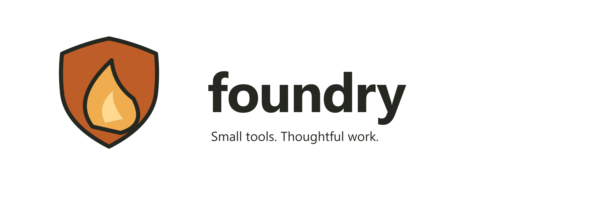

<div align="center">
  <picture>
    <source media="(prefers-color-scheme: dark)" srcset="assets/banner-dark.png" />
    
  </picture>
  <h1>Foundry</h1>
  <p><strong>Five plugins that keep a coding session on its task.</strong></p>
</div>

<p align="center"><a href="#install"><strong>Get started</strong></a> · <a href="#the-plugins">The plugins</a> · <a href="#requirements">Requirements</a> · <a href="#support">Support</a></p>

## The plugins

Foundry is a plugin marketplace for Claude Code. Each plugin works on its own, so install only the one you need.

| Plugin | Use it when | Hosts |
| --- | --- | --- |
| [Foreman](https://github.com/V-Songbird/foreman) | The next session needs the plan, the next task and a checked handoff | Claude Code, Codex and Antigravity |
| [Hush](https://github.com/V-Songbird/hush) | Running commentary buries the result you asked for | Claude Code |
| [Razor](https://github.com/V-Songbird/razor) | A small change keeps growing into new packages and files | Claude Code, Codex and Antigravity |
| [Anneal](https://github.com/V-Songbird/anneal) | An agent searches, rereads or guesses its way around the repository, or the docs no longer match the code | Claude Code, Codex and Antigravity |
| [Collet](https://github.com/V-Songbird/collet) | A session edits files its task never named, or calls the work done before its check passes | Claude Code, Codex and Antigravity |

Claude Code is the primary host: every plugin is designed for it first. Codex and Antigravity are compatibility hosts.

Each plugin's page holds its commands, settings, limits and measurements.

[Flint](https://github.com/V-Songbird/flint) is not a plugin. It is two text files with the same writing voice and coding rules, for a session where you do not want to install anything.

## Requirements

- Claude Code 2.1.323 or later. For every plugin but Hush, a Codex host with plugin support or the Antigravity CLI also works.
- Node.js 22 or later, and Git on the PATH. Foreman needs Git 2.25 or later.

The plugins run their hooks and tests with Node.js.

## Install

### Claude Code

Inside Claude Code, add the marketplace once. Then install the plugin you want:

```text
/plugin marketplace add V-Songbird/foundry
/plugin install foreman@foundry
```

Start a new session to load the plugin. Its skills then appear under the plugin's name, for example `/foreman:foreman`.

To remove it, run `/plugin uninstall foreman@foundry`.

An install stays at the release it was made from. To take a new release, run these and start a new session:

```text
/plugin marketplace update foundry
/plugin update foreman@foundry
```

### Codex

Every plugin but Hush installs the same way. Hush has no Codex package.

```text
codex plugin marketplace add V-Songbird/foundry
codex plugin add razor@foundry
```

Review and trust the plugin's hooks with `/hooks`. Then start a new Codex session.

To take a new release, refresh the marketplace, remove the plugin and add it again. Then start a new session:

```text
codex plugin marketplace upgrade
codex plugin remove razor@foundry
codex plugin add razor@foundry
```

Claude Code and Codex both use the name `foundry`, and each reads its own catalog. Each entry pins one commit of the plugin's repository, so an install stays the same until the catalog moves.

### Antigravity

Antigravity has no marketplace for third-party plugins. It installs a plugin from a clone of this repository. Every plugin but Hush has an Antigravity package.

You need Git and the Antigravity CLI. Replace `<path-to-clone>` with a folder of your choice:

```shell
git clone --recurse-submodules https://github.com/V-Songbird/foundry.git <path-to-clone>
agy plugin install <path-to-clone>/razor
agy plugin list
```

The list names the plugin when the install worked. Start a new conversation to load it.

The clone checks each plugin out at the commit the catalogs pin. So Antigravity gets the same release as Claude Code and Codex.

The install is a copy, so it stays at that commit. To take a new release, update the clone, install again and start a new conversation:

```shell
git -C <path-to-clone> pull
git -C <path-to-clone> submodule update --init
agy plugin install <path-to-clone>/razor
```

### If an update fails

On 2026-11-14 this repository's history was rewritten. A clone made before that date cannot pull the new history.

| What fails | What to do |
| --- | --- |
| `git pull` in an old clone | Delete the clone, clone again as above and install again |
| `/plugin marketplace update foundry`, for a marketplace added before that date | Remove the marketplace and add it again |
| `codex plugin marketplace upgrade`, for a marketplace added before that date | Remove the marketplace and add it again |

Foundry has no configuration of its own. Each plugin's page lists its settings.

## Development

This repository holds the two catalogs, the commit each plugin is pinned at, the check that validates them and this page's banner. Each plugin is developed and tested in its own repository, linked in the table above.

The plugins are Git submodules. Clone with them:

```shell
git clone --recurse-submodules https://github.com/V-Songbird/foundry.git
```

Run a plugin's tests from its own directory. You need Node.js 22 or later and Git:

```shell
cd foreman
node --test tests/*.test.js
```

The command reports each test and exits non-zero on failure.

From the root, two commands check the packages:

| Command | What it checks | What you see |
| --- | --- | --- |
| `claude plugin validate .` | The Claude Code catalog | `Validation passed` |
| `agy plugin validate foreman` | A plugin's Antigravity package | The validator's result for that plugin |

A release moves the plugin's version in its own repository, then the commit pins in both catalogs. The Claude Code catalog repeats that version in the plugin's entry, and the Codex catalog carries none. A plugin listed in both catalogs pins the same commit in both.

## Support

| You want to | Go to |
| --- | --- |
| Report a bug or ask about the catalogs | The [Foundry issue tracker](https://github.com/V-Songbird/foundry/issues), the only listed channel |
| Report a problem in a plugin | That plugin's own issue tracker, linked from its page |
| Report a vulnerability | The private address in that plugin's `SECURITY.md`. Do not post details publicly. The catalogs have no separate policy. |
| See what changed | Each plugin's releases page on GitHub |

## License

MIT. See [LICENSE](LICENSE).
